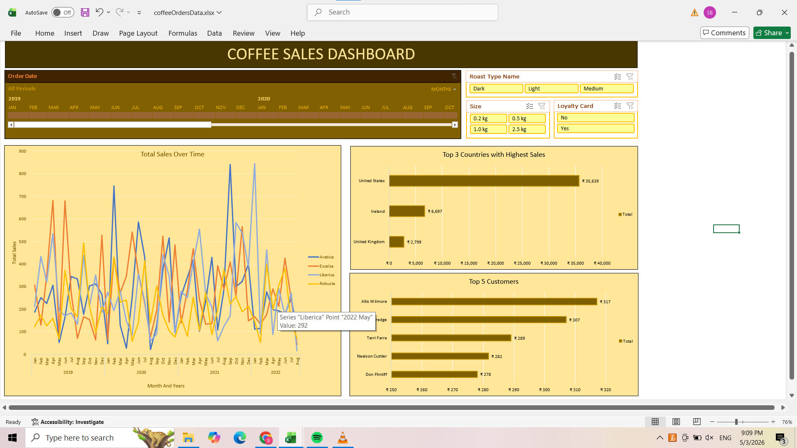

# Coffee Sales Dashboard (Excel)

An interactive Excel dashboard that analyzes coffee order data from 2019 to 2022 to show sales trends, top markets and customer behavior.

## Dataset
- **Source:** [public Kaggle dataset / name the source and link]
- **Size:** 1,000 transactions, Jan 2019 to Aug 2022
- **Coverage:** 3 countries (United States, Ireland, United Kingdom) and 4 coffee types (Arabica, Excelsa, Liberica, Robusta)
- **Fields:** order date, customer, country, coffee type, roast type, bag size, loyalty card, sales

## Key Findings
- The **United States** generated **79% of sales** (Rs. 35,639 of Rs. 45,135), followed by Ireland (Rs. 6,697) and the UK (Rs. 2,799).
- **2.5 kg bags** contributed **52% of revenue** (Rs. 23,786). *[Confirm this figure in your Pivot Table.]*
- The **top 5 customers** each spent Rs. 278 to Rs. 317, so no single customer dominates sales.
- Monthly sales vary widely by coffee type across 2019 to 2022. *[Add one specific trend you observed, such as a peak month, if you want.]*

## Dashboard Features
- **Timeline slicer** to filter by order date
- **Slicers** for roast type, bag size and loyalty card status
- **Line chart:** total sales over time by coffee type
- **Bar charts:** top 3 countries by sales and top 5 customers
- Pivot Tables linked to all charts, so every visual updates together

## Excel Skills Used
- Pivot Tables and Pivot Charts
- Slicers and timelines
- VLOOKUP to bring customer and product details into the order data *[adjust to what you actually used it for]*
- Chart design and dashboard formatting

## How to Use
1. Download the `.xlsx` file and open it in Microsoft Excel (2016 or later).
2. Use the slicers and the timeline to filter by date, roast type, bag size or loyalty status.
3. All charts update with your selection.

## What I Learned
- Turning raw transactions into a clear, interactive dashboard
- Structuring Pivot Tables so several charts share one set of filters
- Reading business insights, such as market concentration and product mix, from the data
